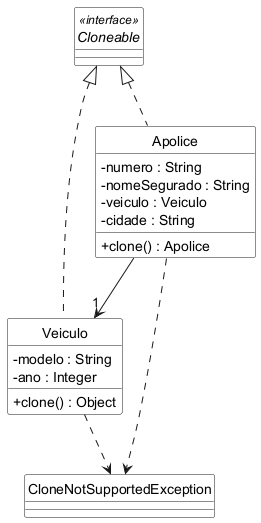

# Prototype

Trabalho da disciplina Aspectos Avançados em Engenharia de Software.

Exemplo do padrão Prototype em Java, com testes em JUnit 5. O tema é o mesmo da
seguradora usada nos trabalhos anteriores: na renovação, a apólice nova é quase
igual à do ano anterior, então em vez de montar tudo de novo a apólice é
clonada e só os dados que mudaram são alterados.

O clone também copia o veículo, e não só a referência para ele. Assim, mudar o
ano do veículo na apólice nova não altera a apólice antiga.

## Diagrama de classes

